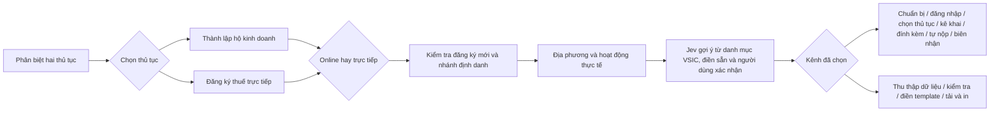

# Wizard đăng ký kinh doanh và đăng ký thuế

## Luồng đã triển khai

Hội thoại, hướng dẫn và mockup cùng đọc một state. Thay câu trả lời giữ dữ liệu có thể dùng lại nhưng hủy xác nhận của các bước sau. Không cho xuất hồ sơ khi còn bước cần xác nhận hoặc thiếu trường bắt buộc. Chuyển từ online sang trực tiếp phải bổ sung dữ liệu hồ sơ còn thiếu. Chưa có biên nhận không được chuyển sang trạng thái đã nộp.

Desktop có ba vùng khi online, hai vùng khi trực tiếp. Mobile dùng ba thẻ Hỏi đáp, Bước hiện tại, Hình ảnh; không ép ba cột vào chiều ngang điện thoại. Các lựa chọn thủ tục, kênh nộp, tình trạng đăng ký, định danh và chủ thể thành lập dùng nút. Thông tin hồ sơ có nhãn giải thích và nguồn đối chiếu.

## Dữ liệu và nguồn

- Nội dung phân biệt: NĐ168/2025 đọc cùng NĐ296/2026. Cá nhân thành lập hộ vẫn là hộ kinh doanh; đăng ký thuế trực tiếp không thay giấy phép hoặc nghĩa vụ đăng ký hộ.
- Thuế: Điều 21 và mẫu 03-ĐKT TT90/2026. Công dân Việt Nam có dữ liệu dân cư là nhánh được điền tự động. Nhánh định danh khác được chuyển sang hướng dẫn đối chiếu mẫu gốc. Đã có đăng ký hoạt động thì chuyển sang thủ tục thay đổi.
- Hộ kinh doanh: mẫu số 1 Phụ lục II TT68/2025. Đã đọc hai trang đầu TT121/2026: văn bản này thay các mẫu Phụ lục I; không thay mẫu hộ tại Phụ lục II. Template được tách từ Word công bố trên cổng đăng ký kinh doanh. Giữ nội dung, bảng và chú thích đúng mẫu; không dùng LLM soạn hồ sơ.
- Ngành nghề: 495 mã cấp 4 từ trang tra cứu chính thức, QĐ36/2025, hiệu lực 15/11/2025. Danh mục có version, nguồn và hash. Tìm kiếm có/không dấu theo từ trong tên hoặc mã, sau đó người dùng xác nhận. Không suy mã từ tên nền tảng; không lấy 888 làm mã VSIC. Chín ngành đã đối chiếu trực tiếp PDF được kiểm tra khớp tên với bảng trên cổng.
- Nguồn đầy đủ nằm trong `wizardModel.ts`, `vsic2025.json` và `public/documents/registration-templates.json`.

## Hình minh họa

Theo điều chỉnh của chủ dự án ngày 17/10/2026, hiện dùng mockup và ghi rõ không phải screenshot cổng thật. Có các cảnh chuẩn bị, đăng nhập, chọn thủ tục, kê khai, đính kèm, nộp và biên nhận. Mockup dùng dữ liệu giả cố định, không lấy định danh người dùng. Tên/vị trí chức năng trên cổng thật chưa được xác nhận qua ảnh. Khi bổ sung ảnh thật phải gắn URL nguồn, ngày chụp, bước áp dụng và ngày kiểm chứng; không tiếp tục dùng ảnh khi cổng đã đổi.

## Hồ sơ và bảo mật

- Mặc định tải HTML có thiết lập A4, không JavaScript và không phụ thuộc mạng khi mở/in; có thể lưu PDF qua chức năng In. Các hình VML trang trí bị chuyển thành mảng đen khi xuất HTML đã được loại khỏi bản in HTML; giữ nội dung và dấu chọn bằng ký tự. Bản Word được cung cấp thêm.
- File có phần biểu mẫu điền sẵn và phiếu chuẩn bị đi nộp riêng. Giữ ngày ký/chữ ký để người dùng tự ghi và ký. Các giấy tờ ủy quyền vẫn cần chuẩn bị theo trường hợp, không được tự tạo chữ ký hoặc chứng thực.
- Hộ do gia đình thành lập: bảng thu thập và điền từ 2–10 thành viên, bao gồm chủ hộ; người dùng phải chuẩn bị văn bản ủy quyền và ký trên bản giấy. Nhiều hơn 10 thành viên cần mở rộng mẫu gốc.
- Địa chỉ cơ quan cụ thể và lệ phí phải tra tại cổng địa phương; hiện chỉ xác định loại cơ quan, địa bàn và hướng dẫn tra nguồn, không bịa địa chỉ.
- State chỉ tồn tại trong bộ nhớ của tab, không lưu localStorage/sessionStorage. Riêng mô tả hoạt động và tối đa 3 câu làm rõ được gửi đến `/api/registration-guide/industry` để Jev (hoặc Quyet theo cấu hình hiện tại) gợi ý một mã từ toàn bộ 495 mã đã lưu. Không gửi các ô định danh, địa chỉ, ngân hàng hay toàn bộ answers. Tên ngành lấy từ catalogue, không lấy từ văn bản model tự sinh. Chỉ điền sẵn, không tự xác nhận hay đi tiếp. Thiếu dữ kiện hoặc độ tin cậy dưới 0,8 thì hỏi làm rõ; lỗi thì cho thử lại/tra thủ công. Không dùng từ khóa để phân loại ngữ nghĩa.
- Endpoint độc lập, một HTTP request với hai Choice chạy song song, timeout 20 giây; không qua RAG/guard/reviewer của hỏi thuế. Toàn bộ 495 mã được chia thành 248/247 mã, mỗi nhóm có tùy chọn không phù hợp/hỏi rõ; mỗi Choice dưới 255 lựa chọn theo [giới hạn chính thức Jev](https://docs.typesafe.ai/primitives/choice). Gợi ý cần độ tin cậy tối thiểu 0,8 và cách mã cạnh tranh ít nhất 0,2; đây là ngưỡng sản phẩm cho gợi ý cần xác nhận, không phải xác suất bảo đảm đúng. Hai mã cạnh tranh thì hỏi hoạt động chính. Miễn lượt chat, giới hạn nguyên tử 12 lần/IP/giờ và 500 lần/ngày toàn hệ thống trên D1; bộ đếm chỉ lưu hash IP, không lưu nội dung. D1/provider lỗi thì dừng gợi ý, vẫn tra danh mục được. Đổi mô tả xóa mã cũ; quay lại/làm lại hủy kết quả cũ. Không gọi model khi nhập từng ký tự.
- Tải template là yêu cầu đến file tĩnh, không kèm dữ liệu hồ sơ. Đóng hoặc tải lại tab sẽ mất dữ liệu chưa tải ra file.
- Không yêu cầu mật khẩu, OTP, PIN. Câu hỏi nghiệp vụ thuế mở luồng hỏi thuế hiện có, giữ nguyên state wizard trong trang.

## Kiểm thử và bảo trì

`npm run test:registration-wizard`: bốn nhánh hoàn chỉnh bằng dữ liệu giả, đổi lựa chọn, hủy xác nhận, dữ liệu thiếu, mã ngành mơ hồ/không có, nhánh ngoài phạm vi, bảng gia đình 2 và 10 người, mapping Word/HTML, escape XML/HTML và render React của các vùng. Không gọi model API.

`npm run test:registration-industry`: kiểm tra hợp đồng Jev, mã/tên chính thức, giới hạn payload, provider lỗi, mã lạ, độ tin cậy thấp, hỏi làm rõ, hủy/bỏ phản hồi cũ; chạy handler giao diện thật để xác minh mô tả → điền sẵn → người dùng xác nhận, không tự đi tiếp. Không gọi API thật. Production cần migration `d1/migrations/20261017_registration_industry_limits.sql`; bảng riêng `registration_industry_limits` không bật/thay đổi rate-limit chat thuế.

Hai mẫu Word được dựng thành PDF bằng bộ render tài liệu và kiểm tra ảnh trang. Việc tách biểu mẫu phải tái đánh số và lọc chú thích theo reference, tránh kéo chú thích của những mẫu khác trong tập Word gốc. Đây là kiểm tra cần giữ khi cập nhật template.

`scripts/update_registration_industries.py` cập nhật bảng từ cổng chính thức; thay số lượng/version nguồn phải được rà soát trước khi phát hành. `scripts/build_registration_templates.py` tạo template từ nguồn gốc đã lưu; chuyển các DOCX template sang HTML bằng LibreOffice rồi chạy `scripts/prepare_registration_html.py`. Mọi thay đổi template cần dựng và xem lại ảnh trước khi phát hành.

Công cụ trình duyệt trong Work hiện bị tắt; chưa kiểm thử thao tác bấm trên trình duyệt thật hoặc nộp hồ sơ cổng production. Các bước xác thực, ký và nộp luôn do người dùng thực hiện trên cổng chính thức.
